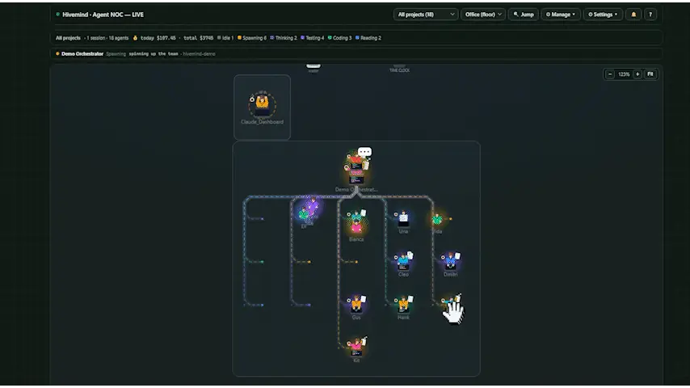
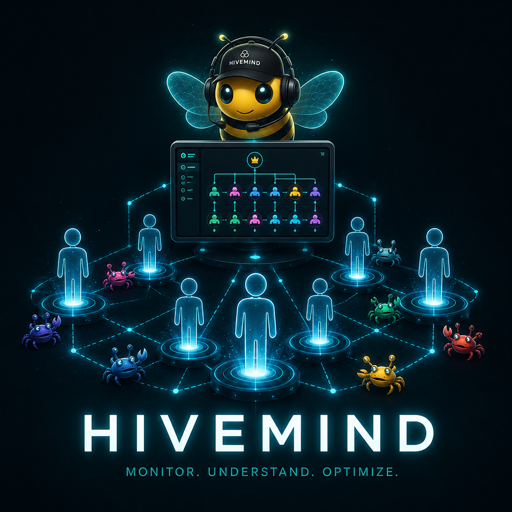
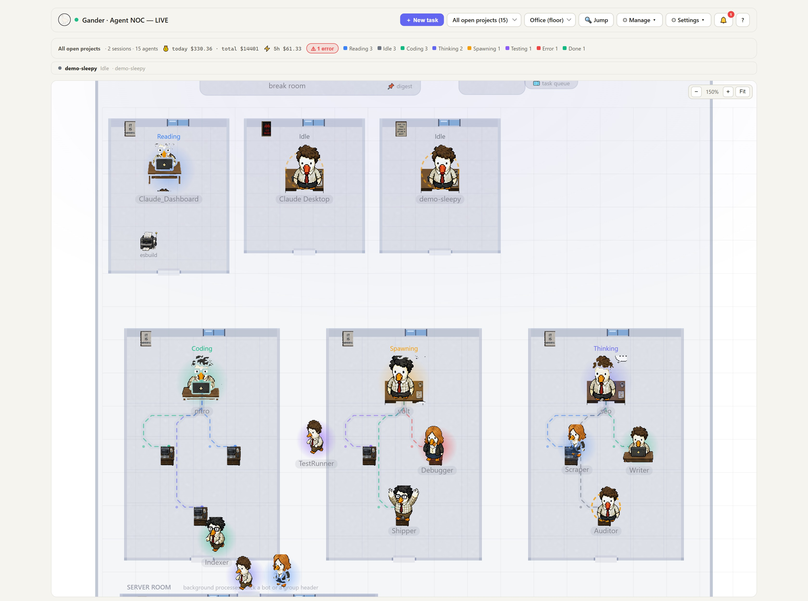

<h1 align="center">Gander: the control room for Claude Code agents</h1>
<p align="center"><strong>See every session on one floor. Get pinged the moment one needs you, even on your phone. Know what it all costs. Stop a bad command before it runs.</strong></p>

<p align="center"></p>
<p align="center"><em>Each goose is a Claude Code session. Thinking, coding, spawning a sub-agent, waiting on you, erroring, done. Live.</em></p>

<p align="center">
  <a href="https://weellio.github.io/gander/demo/"><strong>▶ Try the live demo</strong></a> (nothing to install) ·
  <a href="#install"><strong>Install in one line</strong></a> ·
  <a href="docs/FEATURES.md">Every feature</a> ·
  <a href="SECURITY.md">What it reads and never sends</a>
</p>

## The problem it solves

You run three, five, ten Claude Code sessions. One of them has been waiting on a yes/no for forty minutes. Another just tried `git push --force`. A third is burning two dollars a minute re-reading the same file. You find out when you tab through the terminals, if you find out at all.

Gander is a local dashboard, fed by Claude Code's own hooks, that turns those sessions into a floor you can watch, a rail that tells you who needs you, and a phone page to answer from the couch. It is free, MIT, zero dependencies, and nothing leaves your machine unless you connect Telegram, Slack or claude.ai yourself.

## Why Gander and not…

| You want | Tool | Gander |
|---|---|---|
| A cost report in the terminal | [ccusage](https://github.com/ryoppippi/ccusage) | Gander shows live spend per session and per project, `$/min` runaway alerts, budgets with a hard stop, and where the money went (shipped vs abandoned). ccusage is great for a script or CI; use both. |
| Usage analytics and error analysis in a web page | [Sniffly](https://github.com/chiphuyen/sniffly) | Gander has the analytics (cache-hit, context fill, what fills it, agent scorecards) plus the live floor, alerts, Allow/Deny from anywhere, and the danger guard. |
| The built-in `claude agents` list, `/cost`, `/usage` | Claude Code | Those show one session, in that session. Gander shows all of them, across projects and machines, and reaches you when you have stepped away. |
| A terminal TUI for one session's live usage | claude-code-usage-monitor | Gander's header carries the real plan-window percentages for every session, and the rest of the dashboard. |

If you only ever run one session at a time and never leave the terminal, you may not need Gander. Everyone else, read on.

## Try it in sixty seconds

**No install:** open the [live demo](https://weellio.github.io/gander/demo/). It is a static page with recorded sessions; the geese walk, the rail fills, nothing is real.

**Install as a Claude Code plugin** (any OS, in any Claude Code session):

```text
/plugin marketplace add weellio/gander
/plugin install gander@gander
```

**Or clone and run the installer:**

```bash
git clone https://github.com/weellio/gander && cd gander
node install.js        # merges Gander's hooks into ~/.claude/settings.json (backed up first); node uninstall.js removes them
```

Then `/hooks` in any open session, or start a new one. The bridge starts itself on your next session and opens the dashboard once at `http://localhost:3131/`. The dashboard is prebuilt; there is nothing to compile.

<p align="center"></p>

## Everything it does

The short list. The long one, with every detail, is [docs/FEATURES.md](docs/FEATURES.md).

- **Live office floor + Mosaic** — a structured top-down office: every session in its own **walled room with a doorway**, rendered as pixel-art **geese** whose poses act out the state (typing, thinking, facepalm on error, celebrating on done); agents walk *through the doors* to the water cooler and clock out when finished.
- **🤖 Process robots + SERVER ROOM** — every background process your sessions leave running, visualized, attributed to its real owner, and killable — with verdicts like *parked 2 days, safe to close* vs *has live work*.
- **🔔 Needs-you rail** — who's waiting on input, errored, or **went quiet mid-goal**, across all projects; answer inline, or ✓ Allow / ✕ Deny the exact permission — for **any** session, terminal ones included (via a `PermissionRequest` hook).
- **🪧 Coordination board** — a per-project shared store the agents post to so a swarm builds on each other's work instead of re-deriving it: notes + findings with build-on lineage, 💎 gems that carry to the next session, file claims, plan review, and escalations that ping you. Human-visible by default.
- **⚡ Gander Dispatch** — host sessions inside the bridge: instant replies, real permission buttons, live plan-window telemetry. Your own `claude` login, plan quota, **no API key**.
- **↯ Direct session inbox · status line · 👥 teams** — replies to plain terminal / VS Code sessions go **straight into Claude Code's own cross-session inbox** (no window typing); a one-line `statusLine` install shows needs-you / queue / review counts in every terminal; Agent Teams' roster, task list and mailboxes render as a **👥 Agent teams** strip when Claude runs one.
- **🛡 Safety**: a **danger guard** checks every shell command before it runs and holds the destructive ones (wipe a drive, force-push main, `reset --hard`, drop a database) until you click **Allow once**, even in bypass mode. Its other half, **stop asking me**, turns prompts you keep approving into one-click allow-rules. Risky commands are never suggested.
- **⚠ Same-file collisions**: two sessions editing the same file at once silently overwrite each other; Gander warns the moment it happens.
- **🌙 Quiet hours + while you were away**: hold phone, desktop and lamp alerts overnight (anything you mark critical still gets through), then one card on your return: what finished, what failed, what is waiting.
- **📈 Improvement tracking**: are your agents actually getting better? Rework and tool-error rates over 60 days, the errors that keep repeating turned into draft CLAUDE.md rules, and every rule you add measured afterwards: working, no effect, or worse.
- **🎮 GPU & local models**: what is on the graphics card, which Ollama / LM Studio models are holding video memory and when they unload, one-click Unload, and **Free the GPU** for when you want the card back. It leaves the driver alone while you game.
- **🎙 Voice control**: "Hey Gander, start a session in WaivePulse and write a report on this." An always-listening ear in the top bar (the browser's own speech recognition, no keys, no server) with a wake word, a small grammar and spoken answers: start or queue a task in a project, reply to or stop a session, allow or deny the pending prompt, ask what's running or who needs you, open any panel or view, mute a project. Anything that starts, sends, stops or allows is read back and waits for your "yes". Hold **V** for one command without the wake word.
- **🔌 Claude connector + Claude Dashboards**: the bridge is a read-only **MCP server** (`/mcp`), so claude.ai, Claude Desktop and Claude Code can ask it anything it knows: sessions on the floor, spend by day / project / model, sub-agent scorecards, the queue, spend forensics. Switch it on in Settings, start the built-in cloudflared tunnel, add it as a custom connector, and a **Claude Dashboard** can run live queries on Gander with every number citing its query. No connector? Download the **dashboard data pack** (every dataset as rows) or any dataset as CSV and attach it instead.
- **🧩 Terminal mod (exact numbers)**: on Claude Code 2.1.287+, a one-click **mod** (in-process hooks) feeds the bridge the engine's own cost, context fill, plan-window percentages and every model request, including inside sub-agents, so those tiles say **exact** instead of estimated, and a one-line Gander band sits above the prompt. Gated by version: an older CLI, the VS Code extension, or another provider keeps the classic hook path with no change.
- **🩺 Setup check**: lints your own Claude Code setup (agents, skills, MCP servers, settings files) and checks that every hook command points at something that exists. Hooks fail silently, so this is the only place you would hear about it.
- **💸 Cost guardrails** — live per-session spend, `$/min` runaway alerts, daily/per-session budgets with an optional hard stop, and 5-hour plan-window pacing.
- **🧠 What fills the context window**: not just how full it is, but what with (tool results by tool, file reads, thinking, CLAUDE.md, conversation) and the biggest single items, with a pointed suggestion when one thing dominates.
- **📊 Session analytics + CLAUDE.md audit** — cache-hit %, context-window fill, a one-click `/compact` nudge, and a deterministic CLAUDE.md trimmer that flags secrets, dead paths, and stale prose.
- **📊 Agent scorecards**: per sub-agent type, its runs, average cost and time, and error rate, so you can see which agents are worth using.
- **🔎 Spend forensics** — where your tokens went and whether it shipped: a *shipped %* (spend that landed a commit vs. exploratory), spend by activity, edit one-shot rate + cost-per-edit, and a waste scan (files re-read many times, unused MCP servers). Deterministic — no model calls.
- **⏪ Session replay** — scrub any session's timeline: what ran when, with cumulative tokens/cost at every moment. Turn it into a **🎬 clip** (an auto-playing page to screen-record) or a **📄 runbook** (the steps that worked, the files changed and how it was verified, ready to hand to whoever implements the fix). **⑂ Fork** any session to try another direction without losing the original.
- **📋 Task queue · 📰 Ship digest · Routines** — line up goals per project, each showing **what it cost, across every attempt**: **⎇ worktree isolation** (parallel tasks in one project), a **🧪 test gate** (only green branches merge), a **👀 review-before-merge** hold (diff + approve / request changes from the rail), `then:` chaining, a **✓ definition of done**, **⊘ competing candidates** (fan a hard goal into N attempts, pick the winner), and it **holds while your plan is rate-limited**. Plus the ship digest and headless morning briefings.
- **Projects control center** — skills, agents, commands, hooks, MCP, `settings.json`, git status/commit/push — for every project, in one place.
- **Tune + Skills usage** — deterministic mining of your own transcripts: your prompting "turn tax" with copy-paste fixes, and which skills actually get used (never-used = context dead weight).
- **🖥 Fleet + Claude Desktop** — all your machines' agents on one floor; a view-only tile for the Claude desktop app.
- **📱 Anywhere**: a thumb-sized **phone console** at `/phone` (Allow / Deny prompts, approve merges, reply to a stuck session), an installable PWA, **Telegram or Slack** two-way chat (reply to agents, `/task` queueing, alerts — Slack via Socket Mode, zero deps), native desktop toasts, smart-light ambient alerts.

**The full feature reference, with every detail: [docs/FEATURES.md](docs/FEATURES.md).**

## Screenshots

<p align="center"></p>
<p align="center"><em>The Office floor — goose agents in walled offices inside one building: doorway-routed walking, a break room, a Ticket Bot queue desk, and process droids in the server room.</em></p>

<p align="center">
  
  &nbsp;
  
</p>
<p align="center"><em>Click any agent to read its task, reply, or stop it (left). A runaway session lights up red with a 💸 $/min badge (right).</em></p>

<p align="center"></p>
<p align="center"><em>Usage &amp; cost — real spend parsed from your <code>~/.claude</code> transcripts.</em></p>

## Install

**Requirements:** [Node.js](https://nodejs.org) 18+ and Claude Code. Windows, macOS and Linux; see [Platform support](#platform-support).

```text
/plugin marketplace add weellio/gander      # in any Claude Code session
/plugin install gander@gander
```

or

```bash
# Windows
setup.bat                  # global: every Claude session on this machine reports in

# macOS / Linux
./setup.sh
```

Then run `/hooks` in any open session (or restart it). The dashboard is **prebuilt**; nothing to compile. On your next session the bridge starts itself and opens the dashboard once.

Full setup: scoped installs, ⚡ Dispatch, Telegram, budgets, smart lights, the VS Code extension, the gander-feed mod, the Claude connector, and every config knob: **[docs/INSTALL.md](docs/INSTALL.md)**. What Gander reads, what it never sends, and what the installer changes: **[SECURITY.md](SECURITY.md)**.

## Documentation

| Doc | What's in it |
|---|---|
| [docs/FEATURES.md](docs/FEATURES.md) | The full feature reference — floor, robots, Dispatch, rail, analytics, control-center panels |
| [docs/INSTALL.md](docs/INSTALL.md) | Setup, optional features, VS Code extension, plugin install, configuration reference |
| [docs/COORDINATION.md](docs/COORDINATION.md) | The coordination board — how agents leave notes/findings for each other, escalate to a human, and the token-cost story |
| [docs/OTHER-MODELS.md](docs/OTHER-MODELS.md) | Other models (router = full experience) + other agent CLIs (Codex, Gemini, Grok, aider…) via `gander-wrap`, with the works-anywhere vs Claude-only matrix |
| [docs/ARCHITECTURE.md](docs/ARCHITECTURE.md) | How the hooks wire up, file layout, event API, manual/headless control, contributing |
| [docs/FAQ.md](docs/FAQ.md) | Common questions — also in-app under the **?** button |
| [docs/REMOTE.md](docs/REMOTE.md) | The phone console, the PWA, Tailscale/cloudflared, multi-machine fleet, access tokens |
| [hardware/README.md](hardware/README.md) | Build a **$4 USB-powered ambient alert lamp** — parts, wiring, firmware |

## Platform support

Developed and exercised daily on **Windows**. The dashboard, the bridge, the hooks, the usage and cost analytics, the needs-you rail, Allow/Deny, the queue, the connector and the mod are plain Node and browser code and run the same everywhere. The parts that touch the operating system differ:

| | Windows | macOS | Linux |
|---|---|---|---|
| Start a session / New task / queue launches | ✓ | ✓ Terminal.app | ✓ first of x-terminal-emulator, gnome-terminal, konsole, xfce4-terminal, kitty, alacritty, xterm |
| Desktop alerts | ✓ toast | ✓ | ✓ needs `notify-send` |
| Quick-keys and the idle nudge (typing into a session window) | ✓ by PID or title | partial: targets the frontmost VS Code window, not Terminal.app; needs Accessibility permission | X11 only (`xdotool`), not Wayland |
| Server room (processes, ports, robots), window focus, folder picker, GPU priority | ✓ | not yet | not yet |
| GPU panel | NVIDIA via `nvidia-smi`; Ollama and LM Studio everywhere | Ollama / LM Studio only | NVIDIA via `nvidia-smi`; Ollama / LM Studio |
| Claude Desktop tile | ✓ | running / idle, plus activity from `~/Library/Logs/Claude` | no official build |
| Claude connector tunnel (cloudflared, fetched by the bridge) | ✓ | ✓ | ✓ |

Node 18 or newer. **On macOS or Linux? Please open an issue for anything in the "partial" and "not yet" cells that matters to you; those are the next things to build.**

## Support

Gander is free and always will be. If it saves you time (or money), you can [**buy me a coffee** ☕](https://www.paypal.com/ncp/payment/G8NNLNUHD6SFW) — and a ⭐ on the repo genuinely helps.

## License

**MIT** — free and open source. Use it, fork it, ship it. Issues and PRs welcome.
